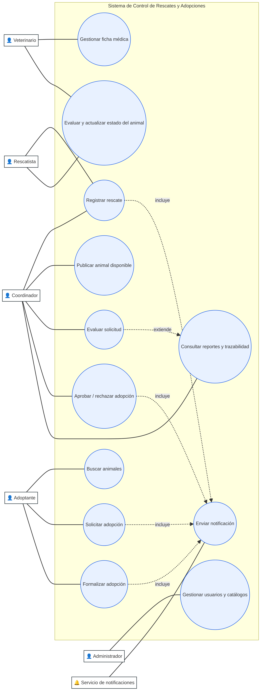
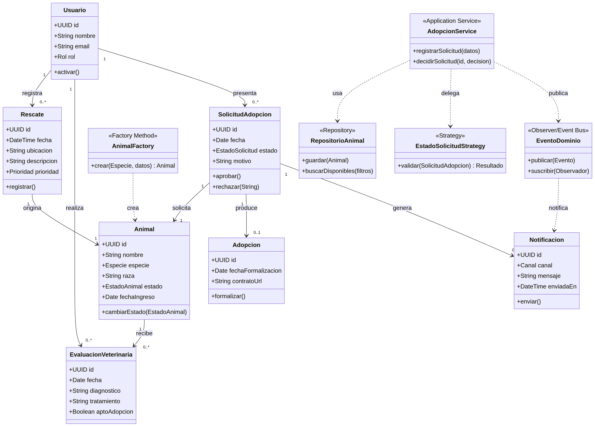
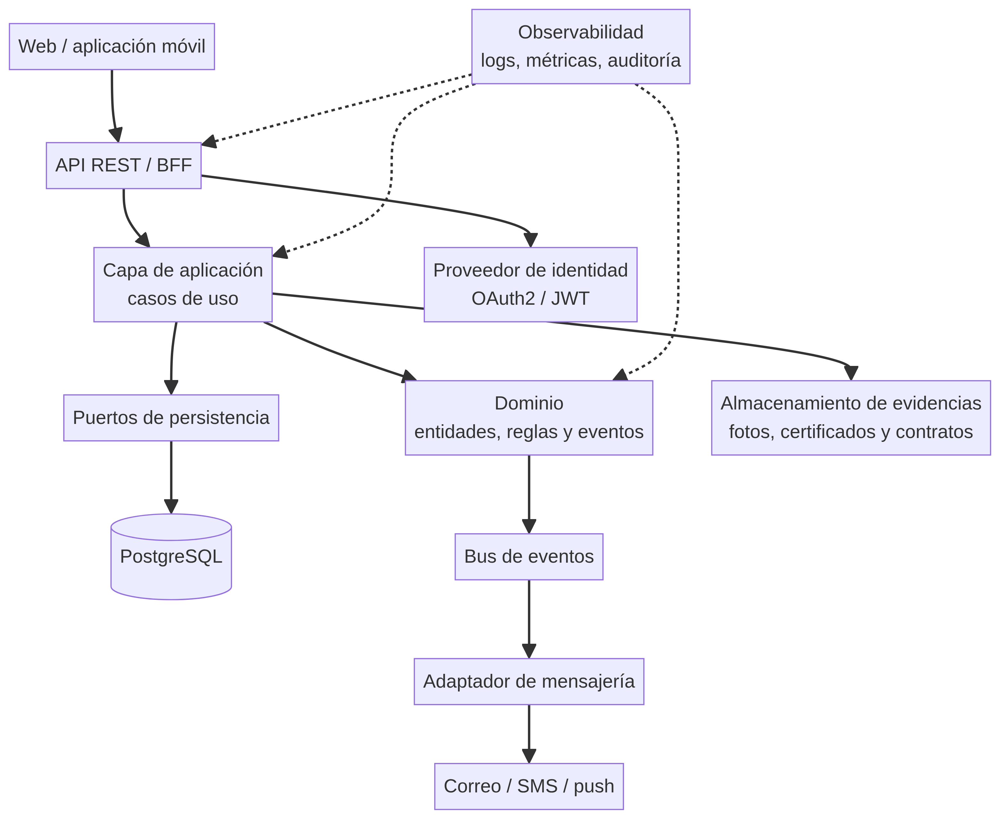

# Diseño de la arquitectura lógica
## Sistema de Control de Rescates y Adopciones

**Asignatura:** Ingeniería de Software / Arquitectura y Diseño

**Actividad:** Análisis de escenario, modelado UML, patrones de diseño y flujo Gitflow

**Autor:** ______________________________

**Fecha:** 7 de octubre de 2026

> **Nota de alcance.** La guía técnica de la Unidad 1 y su rúbrica no fueron adjuntadas al enunciado recibido. Por ello, este informe usa un escenario base razonable y deja explícitos sus supuestos para que puedan contrastarse con el caso oficial antes de la entrega.

## 1. Resumen ejecutivo

Se propone una arquitectura lógica modular para registrar rescates, mantener la historia clínica y operativa de cada animal, publicar animales disponibles y gestionar solicitudes de adopción hasta la formalización del contrato. La solución separa presentación, aplicación, dominio e infraestructura, de modo que las reglas de negocio no dependan de una base de datos, proveedor de correo o interfaz específica.

La propuesta aplica cuatro patrones de diseño principales:

1. **Factory Method** para crear animales con datos iniciales coherentes según la especie.
2. **Strategy** para encapsular políticas de evaluación de solicitudes.
3. **Observer / Event Bus** para desacoplar los cambios de estado de las notificaciones y la auditoría.
4. **Repository** como patrón arquitectónico de persistencia, manteniendo el dominio independiente de PostgreSQL.

El repositorio local preparado sigue una estructura compatible con Gitflow: `main`, `develop`, ramas `feature/*` y `release/*`. El enlace público de GitHub debe sustituirse por el URL real del repositorio del estudiante una vez publicado.

**Enlace público de GitHub:** `https://github.com/<usuario>/control-rescates-adopciones`

## 2. Supuestos y límites del escenario

Para convertir el enunciado general en requisitos verificables se adoptan los siguientes supuestos:

- Una organización protectora coordina rescates y adopciones.
- Un **rescatista** registra el evento de rescate; un **coordinador** valida y administra el caso.
- Un **veterinario** registra evaluaciones, tratamientos y la aptitud para adopción.
- Un **adoptante** consulta animales publicados y envía una solicitud.
- El **coordinador** evalúa la solicitud y decide su aprobación o rechazo.
- El sistema conserva trazabilidad de quién hizo cada cambio y cuándo.
- Las evidencias pueden ser fotografías, documentos clínicos y contrato de adopción.
- La notificación puede enviarse por correo, SMS o notificación push.
- La autenticación y autorización se delegan en un proveedor OAuth2/JWT.
- El alcance no incluye pagos, logística de transporte ni seguimiento veterinario posterior a la adopción; estos quedarían como futuras extensiones.

## 3. Actores y responsabilidades

| Actor | Responsabilidades principales |
|---|---|
| Rescatista | Registrar rescates, ubicación, fecha, descripción y evidencia inicial. |
| Coordinador | Validar rescates, publicar animales, revisar solicitudes, decidir y consultar reportes. |
| Veterinario | Registrar diagnóstico, tratamiento, vacunación y aptitud para adopción. |
| Adoptante | Buscar animales, consultar ficha y presentar solicitud con sus datos. |
| Administrador | Gestionar usuarios, roles, catálogos y parámetros del sistema. |
| Servicio de notificaciones | Entregar avisos de recepción, cambios de estado y decisión. |

## 4. Requerimientos del sistema

### 4.1 Requerimientos funcionales

| ID | Requerimiento |
|---|---|
| RF-01 | El sistema debe permitir registrar un rescate con fecha, ubicación, descripción, prioridad y evidencia. |
| RF-02 | El sistema debe asociar un animal a su rescate y mantener una ficha única. |
| RF-03 | El veterinario debe poder registrar evaluaciones y actualizar el estado clínico. |
| RF-04 | El coordinador debe poder publicar u ocultar un animal según sus condiciones. |
| RF-05 | El adoptante debe poder buscar animales por especie, tamaño, edad, estado y ubicación. |
| RF-06 | El adoptante debe poder crear una solicitud de adopción y adjuntar información requerida. |
| RF-07 | El coordinador debe poder evaluar, aprobar o rechazar una solicitud con observaciones. |
| RF-08 | Una solicitud aprobada debe poder convertirse en una adopción formal con contrato. |
| RF-09 | El sistema debe generar notificaciones ante recepción, cambio de estado y decisión. |
| RF-10 | El administrador debe poder gestionar usuarios, roles, especies, estados y parámetros. |
| RF-11 | El sistema debe ofrecer reportes de rescates, animales por estado, solicitudes y adopciones. |
| RF-12 | Toda operación relevante debe quedar registrada en una bitácora de auditoría. |

### 4.2 Requerimientos no funcionales

- **Seguridad:** control de acceso basado en roles; contraseñas y tokens nunca se almacenan en texto plano; protección de documentos privados.
- **Trazabilidad:** cada cambio debe conservar usuario, fecha, operación y valores relevantes.
- **Disponibilidad:** el sistema debe tolerar la caída temporal del proveedor de notificaciones sin perder la transacción principal.
- **Mantenibilidad:** las reglas de negocio deben probarse sin levantar la base de datos ni servicios externos.
- **Escalabilidad:** las notificaciones y reportes pesados deben procesarse de forma asíncrona.
- **Privacidad:** los datos personales del adoptante solo deben ser visibles a roles autorizados.
- **Usabilidad:** formularios con validación, mensajes claros y accesibilidad básica WCAG.
- **Rendimiento:** las búsquedas públicas deben responder en menos de 2 segundos en condiciones normales.

## 5. Reglas de negocio críticas

1. Un animal no puede estar simultáneamente en estado `DISPONIBLE` y `ADOPTADO`.
2. Solo puede publicarse un animal con evaluación veterinaria vigente y apto para adopción.
3. Un adoptante no puede tener más de una solicitud activa para el mismo animal.
4. Al formalizar una adopción, las demás solicitudes activas del animal deben cerrarse o rechazarse automáticamente.
5. El rechazo requiere una observación y no elimina la solicitud.
6. Toda transición de estado debe ser válida según una máquina de estados: `RESCATADO → EN_EVALUACION → EN_TRATAMIENTO → DISPONIBLE → RESERVADO → ADOPTADO`; también se contempla `NO_ADOPTABLE`.
7. Las operaciones de aprobación, rechazo y formalización requieren un usuario con rol autorizado.

## 6. Modelo de casos de uso

El siguiente diagrama identifica actores, casos de uso y relaciones `include`/`extend`.



### 6.1 Caso de uso prioritario: Solicitar adopción

- **Actor principal:** Adoptante.
- **Precondiciones:** usuario autenticado; animal publicado y disponible.
- **Flujo principal:** consultar ficha → completar formulario → adjuntar requisitos → validar datos → registrar solicitud → notificar recepción.
- **Alternativas:** si faltan datos, el sistema indica los campos; si ya existe una solicitud activa, se impide el duplicado.
- **Postcondición:** solicitud creada en estado `RECIBIDA` y disponible para evaluación.

### 6.2 Caso de uso prioritario: Aprobar adopción

- **Actor principal:** Coordinador.
- **Precondiciones:** solicitud en estado `EN_EVALUACION`; animal disponible o reservado.
- **Flujo principal:** revisar solicitud → ejecutar política de evaluación → registrar decisión → reservar animal → notificar al adoptante.
- **Alternativas:** si la política no se cumple, rechazar con motivo; si el animal ya fue adoptado, cerrar la solicitud por indisponibilidad.
- **Postcondición:** solicitud `APROBADA` y adopción pendiente de formalización.

## 7. Modelo de clases



### 7.1 Capas y responsabilidades

| Capa | Responsabilidad | Componentes ejemplo |
|---|---|---|
| Presentación | Exponer API, validar formato y autenticar la petición. | `RescateController`, `AdopcionController` |
| Aplicación | Orquestar casos de uso y transacciones. | `AdopcionService`, `RescateService` |
| Dominio | Entidades, invariantes, eventos y políticas. | `Animal`, `SolicitudAdopcion`, `EstadoSolicitudStrategy` |
| Infraestructura | Persistencia, mensajería, almacenamiento y adaptadores externos. | `AnimalRepositoryJpa`, `EmailNotifier`, `S3EvidenceStore` |

### 7.2 Persistencia mínima sugerida

- `usuarios(id, nombre, email, rol, estado, creado_en)`
- `animales(id, nombre, especie, raza, fecha_ingreso, estado, rescate_id)`
- `rescates(id, fecha, ubicacion, descripcion, prioridad, registrado_por)`
- `evaluaciones_veterinarias(id, animal_id, veterinario_id, diagnostico, tratamiento, apto)`
- `solicitudes(id, animal_id, adoptante_id, fecha, estado, motivo, observaciones)`
- `adopciones(id, solicitud_id, fecha_formalizacion, contrato_url)`
- `notificaciones(id, usuario_id, canal, mensaje, estado, enviado_en)`
- `auditoria(id, usuario_id, entidad, entidad_id, operacion, datos, creado_en)`

## 8. Patrones de diseño aplicados

### 8.1 Factory Method — creación controlada de animales

**Problema:** la creación directa de `Animal` puede duplicar validaciones y olvidar valores iniciales según la especie.

**Solución:** `AnimalFactory` centraliza la creación y puede delegar a fábricas especializadas (`PerroFactory`, `GatoFactory`, etc.). El cliente solicita una abstracción y no conoce el detalle de construcción.

```java
public interface AnimalFactory {
    Animal crear(DatosRescate datos);
}

public final class PerroFactory implements AnimalFactory {
    public Animal crear(DatosRescate datos) {
        return Animal.builder()
            .especie(Especie.PERRO)
            .estado(EstadoAnimal.RESCATADO)
            .fechaIngreso(Clock.systemUTC().instant())
            .raza(datos.raza())
            .build();
    }
}
```

**Beneficio:** encapsula invariantes de creación y facilita incorporar nuevas especies sin modificar el caso de uso.

### 8.2 Strategy — políticas de evaluación de adopción

**Problema:** la política puede variar por especie, tamaño, edad, condición clínica o normativa de la organización; un `if/else` grande sería difícil de mantener.

**Solución:** `EstadoSolicitudStrategy` representa una política intercambiable.

```java
public interface EvaluacionStrategy {
    Resultado evaluar(SolicitudAdopcion solicitud, Animal animal);
}

public final class PoliticaEstándar implements EvaluacionStrategy {
    public Resultado evaluar(SolicitudAdopcion s, Animal a) {
        if (!s.tieneDocumentosMinimos()) return Resultado.rechazo("Faltan documentos");
        if (!a.esAptoAdopcion()) return Resultado.rechazo("Animal no apto");
        return Resultado.aprobable();
    }
}
```

**Beneficio:** permite probar y cambiar políticas sin alterar `AdopcionService`; también habilita políticas configurables en el futuro.

### 8.3 Observer / Event Bus — notificaciones y auditoría

**Problema:** si el servicio de adopción llama directamente a correo, SMS, push y auditoría, queda acoplado a muchos proveedores.

**Solución:** publicar eventos de dominio como `SolicitudRecibida`, `SolicitudAprobada` o `AdopcionFormalizada`. Los observadores reaccionan de forma independiente.

```java
public record SolicitudAprobada(UUID solicitudId, UUID animalId) {}

public final class AdopcionService {
    private final EventBus bus;
    public void aprobar(UUID solicitudId) {
        // validar, cambiar estado y confirmar transacción
        bus.publicar(new SolicitudAprobada(solicitudId, animal.id()));
    }
}

public final class NotificacionHandler {
    public void manejar(SolicitudAprobada evento) {
        // enviar correo/push sin modificar el dominio
    }
}
```

**Beneficio:** desacoplamiento, procesamiento asíncrono y tolerancia a fallos del proveedor de mensajería.

### 8.4 Repository — persistencia reemplazable

**Problema:** las entidades no deben conocer SQL, ORM ni detalles de conexión.

**Solución:** definir un puerto de repositorio en el dominio o aplicación e implementarlo en infraestructura.

```java
public interface AnimalRepository {
    Optional<Animal> buscarPorId(UUID id);
    List<Animal> buscarDisponibles(Filtros filtros);
    void guardar(Animal animal);
}
```

**Beneficio:** pruebas unitarias con repositorio en memoria y posibilidad de cambiar PostgreSQL por otra solución sin reescribir reglas.

## 9. Arquitectura lógica propuesta



La arquitectura recomendada es una **arquitectura hexagonal/modular** dentro de un monolito modular inicial. Es una decisión equilibrada para un proyecto académico: mantiene límites claros y permite evolucionar a servicios independientes solo si el volumen lo justifica.

### 9.1 Flujo de una aprobación

1. `AdopcionController` recibe la petición autenticada.
2. `AdopcionService` carga solicitud y animal mediante puertos.
3. La estrategia seleccionada evalúa requisitos.
4. La transacción cambia la solicitud y el estado del animal.
5. Se publica `SolicitudAprobada` en el bus de eventos.
6. Los handlers envían notificación y registran auditoría.
7. La API devuelve el estado actualizado sin esperar a cada proveedor externo.

### 9.2 Seguridad y observabilidad

- JWT con roles y permisos por endpoint.
- Autorización a nivel de caso de uso, no solo de interfaz.
- Validación de tipo y tamaño de archivos; antivirus para evidencias.
- Cifrado en tránsito y en reposo.
- Logs estructurados sin exponer datos personales innecesarios.
- Correlation ID para seguir una operación desde API hasta notificación.
- Métricas: tiempo de búsqueda, solicitudes por estado, errores de notificación y tiempo de decisión.

## 10. Estrategia Gitflow

### 10.1 Ramas

| Rama | Propósito |
|---|---|
| `main` | Código/documentación estable y entregable. |
| `develop` | Integración de avances terminados. |
| `feature/*` | Desarrollo de una funcionalidad o artefacto aislado. |
| `release/*` | Preparación, revisión y congelamiento de una versión. |
| `hotfix/*` | Corrección urgente sobre `main`. |

### 10.2 Flujo propuesto para esta actividad

```bash
git checkout -b develop main
git checkout -b feature/uml-casos-uso develop
# agregar casos de uso, requisitos y diagrama
git add . && git commit -m "docs: agregar análisis y casos de uso"
git checkout develop && git merge --no-ff feature/uml-casos-uso

git checkout -b feature/arquitectura-patrones develop
# agregar clases, arquitectura y patrones
git add . && git commit -m "docs: documentar arquitectura y patrones"
git checkout develop && git merge --no-ff feature/arquitectura-patrones

git checkout -b release/1.0.0 develop
# revisión final, correcciones de formato y verificación del PDF
git add . && git commit -m "chore: preparar entrega 1.0.0"
git checkout main && git merge --no-ff release/1.0.0
git tag -a v1.0.0 -m "Entrega de arquitectura lógica"
```

### 10.3 Convención de commits

Se utiliza Conventional Commits: `feat:` para funcionalidad, `docs:` para documentación, `fix:` para correcciones, `test:` para pruebas y `chore:` para mantenimiento. Cada commit debe ser pequeño, descriptivo y asociado a una tarea revisable.

### 10.4 Evidencia local preparada

El repositorio incluye las ramas base y de trabajo siguientes:

- `main`
- `develop`
- `feature/uml-casos-uso`
- `feature/arquitectura-patrones`
- `release/1.0.0`

Para cumplir completamente el requisito de **repositorio público**, el estudiante debe crear o seleccionar un repositorio en GitHub, cambiar el remoto y publicar las ramas:

```bash
git remote add origin https://github.com/<usuario>/control-rescates-adopciones.git
git push -u origin main
git push -u origin develop
git push -u origin --all
git push origin --tags
```

Después, se debe reemplazar el enlace provisional de este informe por el URL público real y verificar en GitHub que las ramas sean visibles.

## 11. Matriz de trazabilidad y aceptación

| Requisito | Artefacto | Criterio de aceptación |
|---|---|---|
| RF-01 a RF-04 | Casos de uso + `Rescate`, `Animal` | Un rescate crea ficha y permite actualizar/publicar el animal. |
| RF-05 a RF-08 | Casos de uso + `SolicitudAdopcion`, `Adopcion` | Un adoptante solicita y un coordinador decide y formaliza. |
| RF-09 | Observer / Event Bus | La decisión genera evento y notificación sin acoplar proveedores. |
| RF-10 | Actores + seguridad | Solo administrador gestiona catálogos y usuarios. |
| RF-11 y RF-12 | Arquitectura + auditoría | Reportes consultan trazabilidad y estados históricos. |
| RNF seguridad | Arquitectura | Roles, JWT, protección de archivos y privacidad. |
| RNF mantenibilidad | Patrones + capas | Dominio testeable sin infraestructura. |
| Gitflow | Repositorio | Ramas y merges visibles en GitHub. |

## 12. Conclusiones

La solución propuesta convierte el escenario de rescates y adopciones en un sistema con límites funcionales claros, reglas de negocio explícitas y una base sólida para crecer. UML permite comunicar actores, responsabilidades y relaciones; los patrones reducen acoplamiento y facilitan la evolución; Gitflow deja evidencia ordenada del proceso de diseño.

Antes de entregar, deben realizarse tres verificaciones finales: (1) contrastar los supuestos con la guía y la rúbrica oficiales, (2) publicar las ramas en un repositorio GitHub público y sustituir el enlace provisional, y (3) revisar el PDF en el visor para confirmar que los diagramas y datos del autor estén correctos.

---

**Anexo A. Archivos fuente**

- `diagramas/casos-uso.mmd`: fuente editable del diagrama de casos de uso.
- `diagramas/clases.mmd`: fuente editable del diagrama de clases.
- `diagramas/arquitectura.mmd`: fuente editable de arquitectura lógica.
- `README.md`: descripción breve del repositorio.
